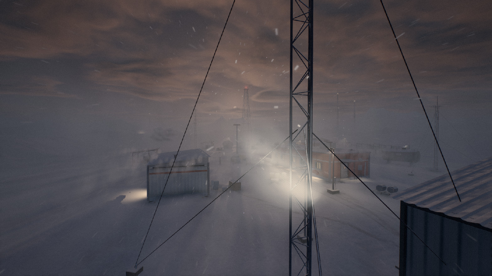
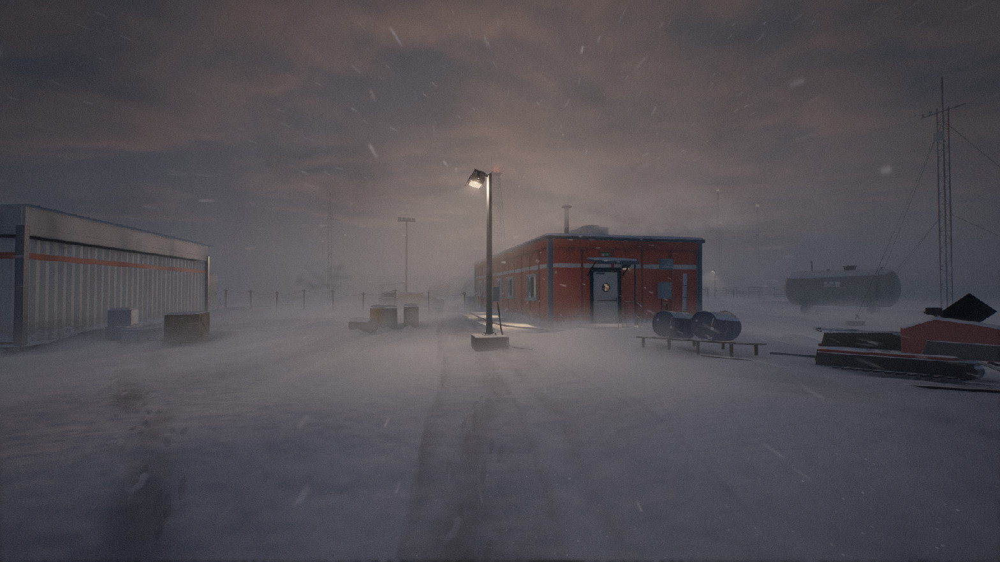
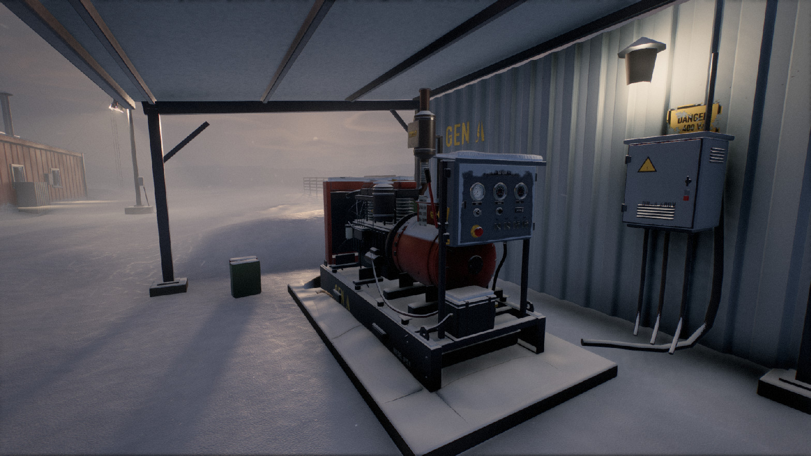
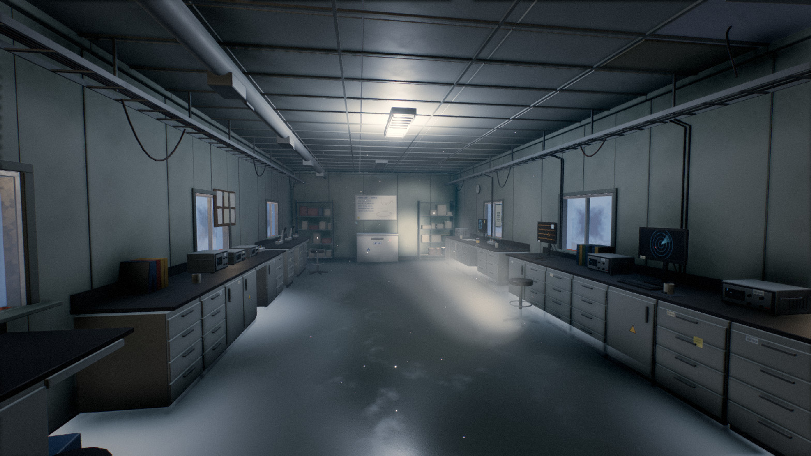
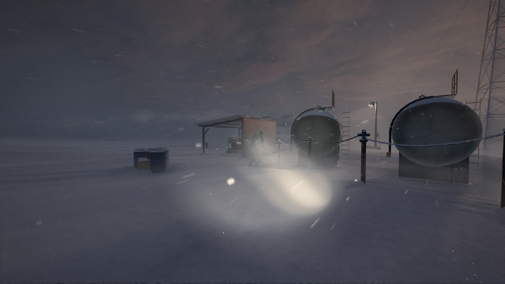
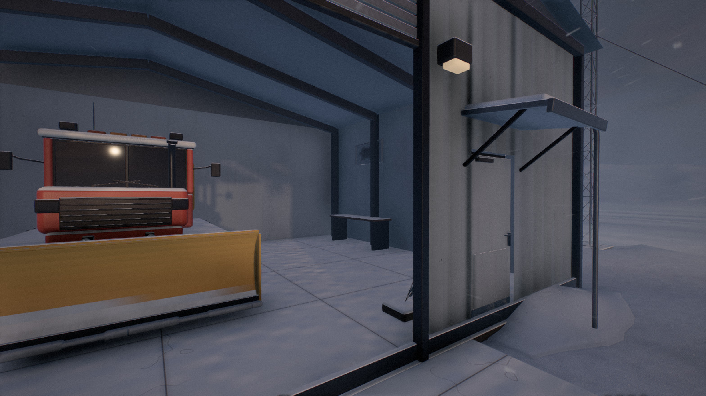

# WHITEOUT, and the skill that made it

**WHITEOUT** is a first-person survival horror game set at a snowbound polar research station at dusk. A blizzard is rising.
You restart three generators to power the radio beacon while something stalks you between the buildings, then call for extraction.

The whole game is **one 1.15 MB HTML file** (`index.html`, 355 KB gzipped). It contains no images, 3D models, textures or audio files:
every building, snowdrift, material, light, cloud and sound is generated by code when the page loads.

It was built from a two-line prompt by **`onefile-aaa`**, a Claude Code skill running on **Claude Opus 5.5** (`claude-opus-5-5`).
The skill is in `skill/onefile-aaa/`.

**Play in your browser:** https://elcronos.github.io/whiteout-onefile/ (desktop Chrome, real GPU), or download `index.html` and open it locally.

| | | |
|---|---|---|
|  |  |  |
|  |  |  |

Screenshots are real-GPU captures (Apple M1 Max) of the shipped file, taken by the skill's own capture tool.

---

## How to play

| Action | Control |
|---|---|
| Look | Mouse (click to capture the pointer) or right stick |
| Move | W A S D or left stick |
| Sprint | Shift. It is loud, and the stalker hears it. |
| Crouch | Ctrl or C. Crouching inside a building hides you. |
| Flashlight | F. The battery drains; spare cells are inside the buildings. |
| Crank a generator | Hold E for 3 s. It is loud. |
| Send the extraction call | Hold E for 5 s at the beacon console |
| Pause / settings | Esc |

Start GEN A, GEN B and GEN C in any order, then send the call from the radio hut. If the stalker reaches you, you lose. Holding
the flashlight beam on it for 1.5 s staggers it and makes it retreat.

---

## What the skill does

`onefile-aaa` turns one sentence, "a *genre* game about *concept*", into a finished, playable 3D browser game that ships as a
single HTML file under 2 MB. It is meant to look like a polished commercial game in screenshots, not a tech demo.

Two things do the work. A **tested rendering cookbook** provides the look, and a **multi-agent production pipeline** of
specialised agents keeps judging and improving it until it passes.

### 1. How it builds procedural worlds (no asset files)

Everything is built from maths at load time, on top of three.js (WebGL2):

- **Geometry from code.** A bevelled, real-scale construction kit (walls, containers, pipes, trusses, tanks, stairs, masts)
  makes buildings and props from parameters, so edges catch light the way real objects do. Organic shapes, such as snowdrifts, rocks and terrain, are
  **signed distance fields** meshed with **surface nets**. Seeded scattering places debris, clutter and vegetation without visible repetition.
- **Textures baked on the GPU.** Materials are not image files. At startup, shaders bake procedural PBR texture sets (albedo,
  normal, roughness, ambient occlusion) for concrete, metal, paint, wood and snow from noise functions. A shared **weathering layer** then adds
  wetness, dust, snow cover, grime and large-scale variation to every surface consistently.
- **Light and atmosphere from physics-style models.**
  - Sky: a procedural sky with clouds also generates the scene's image-based lighting, so ambient light matches the sky.
  - Fog: one analytic height-fog and in-scatter function is shared by every material.
  - Shadows: soft shadows that contact-harden.
  - Lights: practical lights (lamps, flashlights) that actually illuminate surfaces.
  - Weather: rain or snow particles.
- **A film-style image pipeline.** An HDR post-processing chain gives the "shot on a camera" feel:
  - screen-space ambient occlusion;
  - volumetric light shafts ray-marched through the shadow map;
  - bloom and auto exposure;
  - a filmic tonemap with colour grading;
  - anti-aliasing, sharpening, film grain and dithering.
- **Sound from synthesis.** Audio is generated with the Web Audio API: wind, footsteps, machinery and stingers.
- **One file.** esbuild bundles the game and the cookbook into a single `index.html`. A safe GLSL minifier shrinks the shaders.
  The build fails if the file goes over 2 MB.

Each cookbook system was first proven on its own showcase page, on a real GPU, before being used in a game.

### 2. How it produces a game (the pipeline)

The skill runs a deterministic multi-agent workflow, with the main Claude session acting as lead:

1. **Spec and graybox.** Turns the prompt into `SPEC.md` (design, layout, controls, win and lose rules, module plan) and
   `ART.md` (one of 10 look recipes, adapted to the concept), then builds a booting graybox. Gate G1: it builds and renders 6 fixed camera poses with 0 errors.
2. **Look-lock.** Tunes sky, light, fog and colour grade on the graybox until the blind critic signs off on lighting, atmosphere and grade.
3. **Modules.** Parallel "owner" agents each build one part, such as terrain, station, flashlight, generators, stalker AI, HUD, game logic or audio. Each part is reviewed by the critic on its own showcase page.
4. **Integrate and playtest.** Wires everything into `dist/index.html`. A scripted playtest bot must reach both the win and the lose screen (gate G3).
5. **Critic rounds.** Each round:
   - captures the game at fixed poses on a real GPU;
   - has a **blind critic** score it (an agent that sees only images, never code or intent);
   - routes each defect to the agent that owns it, and fixes the defects in parallel;
   - compares the result with the best build so far in a blind A/B test, and reverts any round that made it look worse.
6. **Performance.** Benchmarks frame time with vsync off and optimises (gate G4).
7. **Ship.** Size report, final screenshots, `REPORT.md`.
8. **Self-review.** An honest end-of-run review produces:
   - where the build lands on the skill's own quality bar;
   - whether it beats the best frames the skill has ever shipped;
   - whether it delivers the mood promised in `ART.md`;
   - what in the skill itself got in the way;
   - ranked next steps with costs.

### 3. Its own quality system

The skill judges visual quality by **its own standard**, not by comparing with other games (`references/quality-bar.md`):

- **Score anchors:** per-axis written anchors (lighting, materials, geometry, atmosphere, composition, colour grade, UI,
  stability) describe what a 9, 7 or 5 looks like.
- **Calibration images:** a calibration set of its own frames, `floor/` (a graybox) and `best/` (the best it has shipped). Each run starts
  by re-scoring them to detect critic drift. If the critic cannot tell floor from best, the run warns that the gates can't be trusted.
- **Ratchet:** a bar in `quality-bar.json` that only goes up. When runs pass, the thresholds rise towards a stretch target (no
  major defects, every axis ≥ 7.5, mean ≥ 8). They never drop automatically: if runs fail, the fix goes into the skill.
- **Run log:** `references/run-log.md` records the skill problems each run exposed and whether they were fixed. The next run reads it.

---

## Reproduce WHITEOUT

### Requirements
- **Claude Code**, with the **Workflow** tool (multi-agent orchestration) available, running **Claude Opus 5.5** (`/model`, then choose Opus 5.5).
- **Node.js ≥ 18**, **Google Chrome**, and a machine with a **hardware GPU** and a display. The critic must see real GPU renders;
  cloud or headless machines fall back to software rendering, so the visuals can't be judged.
- Budget: a lot of tokens. WHITEOUT used **56 agents and about 4 M subagent tokens** on the cheapest budget (`quick`), over
  about 9 hours of wall-clock time across two sessions (a usage limit paused it once; the workflow resumed from its cache).

### Install the skill
```bash
git clone https://github.com/elcronos/whiteout-onefile.git
cp -r whiteout-onefile/skill/onefile-aaa ~/.claude/skills/onefile-aaa
mkdir -p ~/.claude/agents && cp ~/.claude/skills/onefile-aaa/agents/onefile-critic.md ~/.claude/agents/
```
Restart Claude Code so it picks up the skill and the `onefile-critic` agent. The critic agent has only the `Read` tool, which
is what keeps it blind to code.

### The prompt used
In an empty working folder, start Claude Code on Opus 5.5 and send:

```
/onefile-aaa Create a first-person survival horror game. Concept: A snowbound polar research station at dusk in a rising blizzard: restart three generators to power the radio beacon while something stalks you between the buildings; reach the beacon tower and call for extraction. Budget: quick. Directory: ./whiteout
```

The skill does the rest: preflight checks, scaffolding (`node <skill>/tools/scaffold.mjs ./whiteout`), the workflow run, the
report and the self-review. Internally the workflow receives exactly these arguments:

```json
{
  "genre": "first-person survival horror",
  "concept": "A snowbound polar research station at dusk in a rising blizzard: restart three generators to power the radio beacon while something stalks you between the buildings; reach the beacon tower and call for extraction.",
  "budget": "quick"
}
```

For WHITEOUT, the workflow was launched with exactly these arguments, after scaffolding the folder. The skill has
been improved since that run, with fixes from its run log, the self-review step and the quality-bar system. A rerun therefore uses a slightly
newer pipeline than the one that made this build.

If a usage limit interrupts the run, tell Claude to resume. The workflow replays finished agents from cache and continues.

Budgets: `quick` (1 look round, 2 critic rounds), `standard` (2 / 4, the default), `full` (3 / 7). Bigger budgets mean more
polish, and proportionally more tokens and hours.

**Expect variation.** The pipeline is a set of agents making design decisions, so a rerun gives a different station, layout and
details, judged against the same gates. Use any other genre and concept the same way, for example:
`/onefile-aaa Create a third-person exploration game about a flooded cathedral at dawn`.

---

## How WHITEOUT scored (honest numbers)

From `whiteout/REPORT.md`:

| Gate | Result |
|---|---|
| G1: boots, 8 poses render, 0 errors on a real GPU | ✅ pass |
| G3: playtest bot reaches win and lose, every action used | ✅ pass |
| Size: under 2 MB, no binary blobs | ✅ pass (1.15 MB, 355 KB gzipped) |
| G2: visual bar | ❌ mean 6.4 meets the bar, but materials 5.5 and 9 major defects fail it |
| G4: frame time at 1080p high | ❌ 16.7 ms average (about 60 fps on an M1 Max) against a 12.5 ms target |

Blind-critic scores: lighting 6.5 · materials 5.5 · geometry 6 · atmosphere 7.5 · composition 6 · colour grade 7 · stability 6.
The critic is deliberately harsh: it lists every flaw a player could notice. The known weaknesses are a flashlight that reads
as a floating glow, volumetric fog that shimmers in motion, snow falling indoors, and an empty far field. All of them are listed in
`whiteout/REPORT.md` and logged as open items in `skill/onefile-aaa/references/run-log.md`.

## Repository layout

```
index.html                 the game (single file, play this)
whiteout/                  SPEC.md, ART.md, REPORT.md (with self-review), screenshots/
skill/onefile-aaa/         the Claude Code skill
  SKILL.md                 entry point Claude reads
  workflows/build-game.js  the multi-agent pipeline
  cookbook/three/          rendering, materials, geometry, weather, audio, post systems
  templates/three/         game template (esbuild single-file build, GLSL minifier)
  tools/                   scaffold, capture, bench, playtest, size report
  agents/onefile-critic.md the blind visual critic
  references/              art direction, genre recipes, rubric, quality bar, run log
```

Third-party code: three.js (MIT), bundled at build time, and a few MIT-licensed noise and meshing helpers. See
`skill/onefile-aaa/THIRD_PARTY_NOTICES.md`.

## License

MIT, see `LICENSE`. Third-party code keeps its own MIT notices in `skill/onefile-aaa/THIRD_PARTY_NOTICES.md`.
